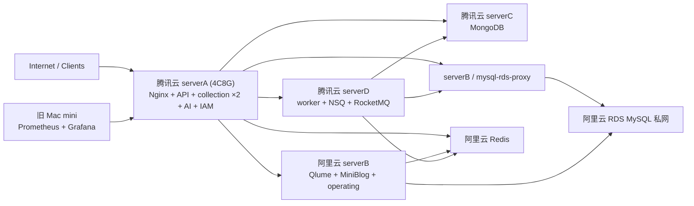

# Infra - 基础设施即代码

> 四节点跨云 Swarm 基础网络层下的基础设施管理仓库。

当前拓扑（2026-10-19 serverA 迁入腾讯云后）：

- `serverA 4C8G`：`nginx + qs-apiserver + qs-collection-server ×2 + qs-ai + IAM + prometheus-route`
- `serverB 2C2G`：`Qlume + MiniBlog + operating + mysql-rds-proxy`
- `serverC 4C4G`：`mongodb`
- `serverD 4C4G`：`qs-worker + NSQ + RocketMQ`
- 旧 Mac mini：`Prometheus + Grafana`
- 阿里云托管：`MySQL`、`Redis`；MySQL 经 serverB 私网代理访问
- 临时压测机：独立 K6 流量发生器，不加入生产 Swarm

## 快速开始

```bash
# 查看所有命令
make help

# 每台新服务器先执行交互式 Linux 初始化
make server-init

# 从 Mac 一键准备临时 K6 压测机（远端不需要预先 clone infra）
make perf-runner-init-remote PERF_RUNNER_HOST=root@203.0.113.10

# 完成一次本机私有配置后，一键同步源码、配置、token 与 preflight
make perf-runner-sync

# 每台机器先加入 Tailscale，Swarm 使用 Tailscale IP 作为节点互联地址
make tailscale-install
make tailscale-up TAILSCALE_HOSTNAME=serverA

# 校验 Tailscale 1280 / overlay endpoint 1230 MTU 策略
make network-mtu-policy-verify
make tailscale-ip

# 初始化四节点 Swarm 网络（全部 IP 使用 tailscale ip -4）
make swarm-init SWARM_ADVERTISE_ADDR=<serverA-ts-ip> SWARM_DATA_PATH_ADDR=<serverA-ts-ip>
make swarm-join-manager SWARM_MANAGER_IP=<serverA-ts-ip> SWARM_TOKEN=<token> SWARM_ADVERTISE_ADDR=<serverB-or-D-ts-ip> SWARM_DATA_PATH_ADDR=<serverB-or-D-ts-ip>
make swarm-join-worker SWARM_MANAGER_IP=<serverA-ts-ip> SWARM_TOKEN=<token> SWARM_ADVERTISE_ADDR=<serverC-ts-ip> SWARM_DATA_PATH_ADDR=<serverC-ts-ip>

# 新 A 首次建立目录后再复制生产配置；配置迁入后不要重复初始化
make init-serverA

# 在对应节点启动 infra 仓库维护的服务
make serverA-up
make serverB-up
make serverC-up
make serverD-up
```

## 文档

详细文档见 [docs/INDEX.md](docs/INDEX.md)。

| 文档 | 说明 |
| ------ | ------ |
| [serverA 腾讯云迁移记录](docs/server/serverA-tencent-migration.md) | 已执行切换、运行证据和回退边界 |
| [架构设计](docs/server/architecture.md) | 四机拓扑、职责边界、服务依赖 |
| [IAM 腾讯云迁移记录](docs/server/iam-tencent-servera-migration.md) | IAM 从 B 迁至新 A 的固定版本、验收和回退边界 |
| [Mongo 迁移手册](docs/server/mongo-migration-to-serverC.md) | Mongo 迁到 `serverC` 的切换顺序、备份恢复与业务改造点 |
| [QPS 容量规划报告](docs/server/qps-capacity-planning.md) | `200/300/500/800/1000 QPS` 分级判断与组件资源建议 |
| [独立 K6 压测机初始化](docs/server/perf-runner.md) | 从 Mac 一条命令准备临时 Linux 压测机 |
| [升降配操作手册](docs/server/scaling-runbook.md) | 拓扑调整、环境变量与发布顺序 |
| [初始化指南](docs/server/initialization.md) | 四台机器的系统初始化 |
| [网络架构](docs/network/architecture.md) | Tailscale underlay + 四节点 Swarm overlay 设计 |
| [组件总览](docs/components/README.md) | MongoDB / NSQ / Nginx 与云托管依赖 |
| [CI/CD 部署](docs/server/github-actions-deploy-guide.md) | GitHub Actions 配置 |

## 架构概览



说明：

- `infra` 维护 A 的 Nginx/监控路由、B 的 MySQL 私网代理、C 的 MongoDB、D 的消息基础设施和 mini 监控。
- IAM、operating、Qlume、MiniBlog、QS 与 AI 等业务容器由各自业务仓库部署。
- 四台机器先加入 Tailscale，Swarm advertise/data-path 使用 Tailscale IP；业务容器共同加入 `infra-network`，跨机容器统一使用 overlay 网络服务发现。

## 项目结构

```text
infra/
├── components/              # 基础设施组件
│   ├── mongo/               # MongoDB
│   ├── nsq/                 # NSQ
│   ├── nginx/               # Nginx
│   ├── networks/            # Swarm / overlay 网络
│   ├── redis/               # 可选/开发用 Redis 组件
│   └── mysql/               # 可选/开发用 MySQL 组件
├── deploy/
│   ├── serverA/             # serverA infra stack
│   ├── serverB/             # serverB 业务节点说明
│   ├── serverC/             # serverC infra stack
│   └── serverD/             # serverD infra stack
├── compose/env/prod/        # 四台机器的生产环境变量模板
├── scripts/                 # 初始化 / 网络 / 组件脚本
├── docs/                    # 架构与运维文档
└── Makefile                 # 管理入口
```

## 常用命令

### 网络与初始化

```bash
make init-serverA
make init-serverB
make init-serverC
make init-serverD
make server-info
```

### 服务器栈

```bash
make serverA-up
make serverC-up
make serverD-up

make serverA-logs
make serverC-logs
make serverD-logs
```

### 组件命令

```bash
make help-mongo
make help-nsq
make help-ssl
make help-vpn
```

## 服务约定

| 服务 | 访问方式 | 位置 |
|------|----------|------|
| `nginx` | `80/443` | `serverA` |
| `nsqlookupd` | `4160/4161` | `serverD` |
| `nsqd` | `4150/4151` | `serverD` |
| `nsqadmin` | `127.0.0.1:4171` | `serverD` |
| `prometheus` | `127.0.0.1:19090` | `旧 Mac mini` |
| `grafana` | `127.0.0.1:13000` | `旧 Mac mini` |
| `mongo` | `127.0.0.1:27017` + overlay `mongo:27017` | `serverC` |
| `mysql-rds-proxy` | 仅 overlay `mysql-rds-proxy:3306` | `serverB` |
| `MySQL` | 云托管私网地址 | 阿里云 |
| `Redis` | 原云托管地址 | 阿里云 |

## License

MIT

监控已迁至旧 Mac mini，运行、私网采集和回滚见 [监控部署说明](deploy/mac-mini/README.md)。
