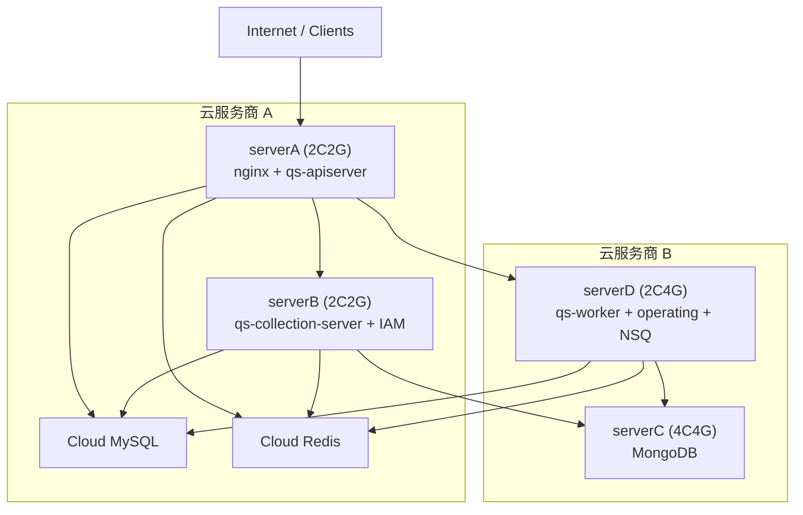

# 服务器架构设计

## 概述

当前生产目标拓扑为：

- `serverA 2C2G`：`nginx + qs-apiserver`
- `serverB 2C2G`：`qs-collection-server + IAM`
- `serverC 4C4G`：`mongodb`
- `serverD 2C4G`：`qs-worker + operating + nsq`
- 云托管：`MySQL`、`Redis`

其中：

- `infra` 仓库直接维护 `serverA`、`serverC`、`serverD` 的基础设施 compose。
- `serverB` 的业务服务由对应业务仓库维护，本仓库只维护网络约定与参考环境变量。
- 四台机器都加入四节点跨云 Swarm，统一接入 `infra-network`。

## 架构图

## 机器职责

### serverA (2C2G)

职责：

- 对外统一入口：`nginx`
- 同机业务：`qs-apiserver`

本仓库管理范围：

- `deploy/serverA/docker-compose.yml`
- `compose/env/prod/serverA.env`

说明：

- `qs-apiserver` 仍由 `qs-server` 仓库部署。
- `serverA` 不再承载本地 Redis、MongoDB 或监控栈。

### serverB (2C2G)

职责：

- 同机业务：`qs-collection-server`、`IAM`

本仓库管理范围：

- `compose/env/prod/serverB.env`
- `deploy/serverB/docker-compose.yml` 仅保留空栈说明

说明：

- `qs-collection-server` 与 `IAM` 由对应业务仓库部署。
- `NSQ` 已迁移到 `serverD`。

### serverC (4C4G)

职责：

- 独占承载 `MongoDB`

本仓库管理范围：

- `deploy/serverC/docker-compose.yml`
- `compose/env/prod/serverC.env`

说明：

- `MongoDB` 对宿主机只绑定 `127.0.0.1:27017`。
- 跨机器业务容器通过 overlay 网络访问 `mongo:27017`。

### serverD (2C4G)

职责：

- `qs-worker`
- `operating`
- 消息中间件：`nsqlookupd`、`nsqd`、`nsqadmin`

本仓库管理范围：

- `compose/env/prod/serverD.env`
- `deploy/serverD/docker-compose.yml`

说明：

- `NSQ` 由 `infra` 仓库维护。
- `qs-worker`、`operating` 由对应业务仓库部署。
- 业务仓库应复用本仓库约定的依赖地址：
  - `mongo`
  - `nsqlookupd`
  - `nsqd`
  - 云托管 MySQL / Redis

## 网络与服务发现

统一约定：

- overlay 网络名：`infra-network`
- MongoDB：`mongo:27017`
- NSQ Lookupd：`nsqlookupd:4161`
- NSQD：`nsqd:4150`

外部入口：

- 所有公网流量先到 `serverA/nginx`
- 内部业务再通过 overlay 网络或云托管数据库访问下游依赖

## 环境变量文件

| 文件 | 用途 |
|------|------|
| `compose/env/prod/serverA.env` | `serverA` 的 nginx 与节点/云依赖基线 |
| `compose/env/prod/serverB.env` | `serverB` 的业务节点与云依赖基线 |
| `compose/env/prod/serverC.env` | `serverC` 的 MongoDB 配置 |
| `compose/env/prod/serverD.env` | `serverD` 的 NSQ 与业务服务参考依赖地址 |

## 当前仓库的边界

`infra` 仓库当前只负责：

- Swarm / overlay 网络
- `nginx`
- `NSQ`
- `MongoDB`
- 四台机器的环境变量基线

不负责：

- `qs-apiserver`
- `qs-collection-server`
- `qs-worker`
- `IAM`
- `operating`

这些服务的容器部署与 CI/CD 仍在各自业务仓库中维护。
