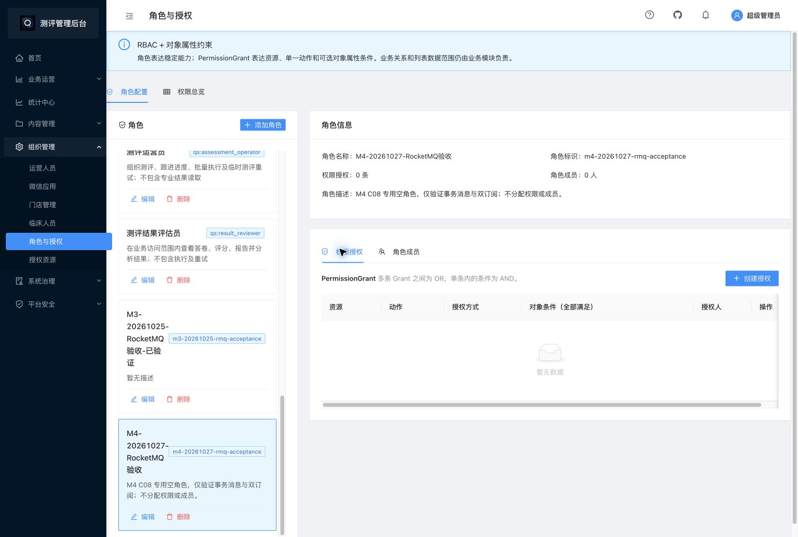

# IAM角色授权详情读取修复

2026-10-27：已修复并上线。生产失败接口确认为角色grants读取，assignments独立返回成功；修复后system页面的两条接口均HTTP200/业务code200，空角色、已有授权、成员和快速切换验收通过。首次CD在旧锁脚本的sudo边界被拒绝；锁修正经完整CI后沿原CD上线，失败历史保留。此项独立于M4原38/38任务，不把空角色创建、双订阅成功当作详情读取通过。

## 现象与证据边界

合法system会话选择`m4-20261027-rmq-acceptance`后，grants为HTTP500、业务code1；assignments为HTTP200、业务code200、`data: []`。两请求分别关联`req-1793069954114-ahj5rlt0`和`req-1793069954115-a8667n1x`。响应正文和服务端错误事件已对应；服务日志没有输出底层错误文本，因此不声称取得生产`ErrWritePlanRequired`原文。前端Promise.all共享toast只能说明至少一个请求失败。

生产运行镜像对应应用源码`4609d4542d9303130ab94ed67593d0a69d0d010d`，运行engine ID及容器身份与M4发布索引一致。该版本与修复前main的permissiongrant/service.go摘要相同。真实Authz模块装配回归在修复前重现HTTP500/code1；代码路径为`ListRoleGrants -> ListByRole -> PlannedUnitOfWork.WithinTx -> ErrWritePlanRequired`，读取callback未执行。

## 修复和保护

[IAM PR158](https://github.com/FangcunMount/iam/pull/158)将`ListByRole`切到现有`ReadOnlyPlanner.ReadPlan`。缺少只读能力时拒绝回退，角色查询和`RequireVisible`保留在同一只读事务内；路由`permission_grants/list`权限保持。`WithinTx`写保护、写计划、策略版本及消息协议未放开。AuthZ应用层逐项扫描后，未发现其他只读服务直接调用`WithinTx`；剩余生产调用仅为`WithinWrite`对旧UOW的写路由。

新增真实`AuthzModule -> CollectREST -> router/handler -> service -> PlannedUnitOfWork -> MySQL`回归，使用显式身份fixture和原生存储sender fixture，不冒充真实system登录或Broker端到端证明。覆盖空列表、有授权及成员、交替角色、无权限拒绝、受保护/缺失角色404、关闭写准入仍可读；断言GET不产生操作头、Sender调用、策略版本及授权/成员、execution、witness、outbox、operation增量。

## 自动CD实际执行发现的独立阻碍

首次[CD40443279869](https://github.com/FangcunMount/iam/actions/runs/40443279869)镜像发布成功，部署在`sudo touch deploy.lock`被受限deploy账号拒绝，发生在配置同步和实例替换前。旧实例、策略177及原锁保持；失败记录不改写。

[IAM PR159](https://github.com/FangcunMount/iam/pull/159)改为核验并只读打开宿主原锁，检查UID/模式/原inode并持有互斥锁，缺失、symlink、权限或inode漂移均拒绝。普通部署不创建、chmod或重建锁；免密包装用`sudo -n`立即拒绝未授权命令，未扩大sudo规则。候选`ea9255c54a21aeb84c41a7d5e1401a81b920dad9`通过8项完整检查后合并`55193a9d8f43baf00e67ff51a407ca8ee43dbcad`；与角色修复后的Go业务源码完全相同。合并后main CI40444830331完整通过，最终CD与真实页面另见下表。

5项描述符/内核flock回归验证复用原锁、缺失不创建、symlink、权限漂移不修补及竞争排斥；测试fixture只投影root ownership，不冒充实际Unix权限证明。另以serverA实际deploy身份核验最终脚本SHA256 `1497d44a202678f1b1eb0b7a51ba0a624d26210bdbb6b6b90abcac7dcf52dcef`并持有原锁、拒绝竞争者，inode820503/0666/UID0/大小0/mtime保持；Redis/MySQL CA普通用户只读验证通过。旧发布窗口或维护ACL没有被绕过。

## 分层验证

| 层次 | 结果 |
| --- | --- |
| 源码 | 候选`89834032e6ba9df8ecd569389d3930b749c5827e`；PR158合并`f1bfef3d5e712e3188b42eee6885201d9591e767` |
| 本地 | 独立MySQL8.0.46原生装配race通过；完整167个有测试包race及go vet通过；涉及包golangci通过 |
| CI | PR9项检查通过；三档MySQL8.0.36/8.0.44/8.4各34项schema用例全部通过，包含新读取回归，零失败/跳过；main CI40442777226、并发40442777315及CodeQL40442776857通过 |
| lint限制 | 本地全仓库make lint在未修改NSQ测试代理文件有3项既有errcheck错误；required CI lint通过，未把本地全仓库lint记为通过 |
| 生产部署 | [CD40445323798](https://github.com/FangcunMount/iam/actions/runs/40445323798)全部通过，11:43:41完成；二进制GitCommit为55193a9d8f43baf00e67ff51a407ca8ee43dbcad，engine d5e51ec9bef40a609251ba35068b89374e5e1caa5124b53f4aab22151552ea97；健康/ready200，0重启、无OOM，UID/GID2000及1GiB/1CPU保持 |
| system页面 | 专用空角色两接口均HTTP200/code200/data[]；QS管理员1条授权/2名成员，成员表2行；连续空角色→QS管理员→空角色最终0/0，网络14条详情GET均200、无错误toast；请求ID分别留证 |
| 数据副作用 | 上线及页面操作前后10项计数完全一致：策略177，witness/execution/operation各3，rm_outbox0，授权137/成员256，Prepared0，专用角色零授权/成员；原锁inode820503和serverA其余6个容器ID保持 |

[完整receipt与原始报告摘要](evidence/iam-role-details-read-fix-20261027.json)记录每层状态及证据限制。[生产只读计数探针](evidence/iam-role-details-read-audit-20261027.go.txt)沿原TLS factory读取运行配置/环境，在ReadOnly/RepeatableRead事务中只输出计数；不导出凭据、不执行DDL或权限数据修复。临时独立测试MySQL及其匿名卷已清理，其他容器/数据库未受影响。

CD的可选镜像保留清理因宿主固定helper与包内版本不一致而按原保护跳过；未绕过检查或更新root工具，旧M4镜像保留。该警告不等于部署或业务验收失败。

