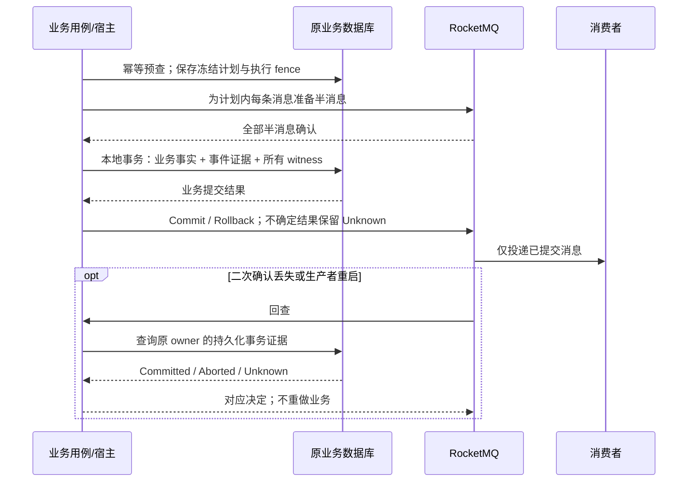

# P. 代码分析报告与 RocketMQ M2 + M3 重构规划

状态：待评审的实施规划；本轮未修改业务代码、数据库、消息资源或生产配置。会话日期：2026-10-18。

结论：开发按 M2（SDK 事务能力）和 M3（业务接入）分批验证，生产只执行一次从“NSQ + 当前 Outbox”到最终 RocketMQ 方案的协调切换。取消尚未执行的“先把业务整体部署为 RocketMQ 普通消息，再改事务消息”中间发布。M1 已完成的 Docker Broker、TLS/ACL、普通消息适配、消费结算、审计和构建能力继续复用。

本文把用户所说的“事件消息”按上下文理解为 RocketMQ **事务消息（TRANSACTION）**。领域事件是业务分类；NORMAL/TRANSACTION 是投递机制，两者不是同一维度。最终方案允许不需要本地事务一致性的通知继续用 NORMAL，避免为它们制造无意义的事务。

## 1. 范围、基线与行为变化

采用 module-design 路径：先建立新旧契约和测试，再改生产者事务边界、消费者及运维，最后退出旧路径。这里包含用户要求的协议能力变化，不能把它描述为完全不改变行为的代码整理。

| 仓库 | 这次核对的 main SHA | 责任 |
| --- | --- | --- |
| reliable-messaging | `18c0c38b5869b60eac5ce238c15d5e5c4048eeea` | 嵌入式 Go/Python SDK、事务协议和存储适配 |
| IAM | `f5788a56dc5437fc033f93760d55181fb847c01d` | 授权事实、策略版本及本地 MySQL 事务 |
| qs-server | `d939a515183f2d25e03eb11e55398a7094eec514` | 答卷、评分、报告、任务、AI 命令与回执 |
| qs-ai | `c288eb94c09a8ac930f0ae6b03d62a09147b72fb` | 模型调用事实、冻结结果、运行状态和回执 |
| infra | `3ca59549884c82065958fa5f74d21624f10dcdfb` | Docker RocketMQ、路由、ACL、运维、交付证据 |

读取了 M1 worktree 的对应实现，并检查上述业务源码目录与 main 无差异；qs-server 另有尚未合入的 build-only 流程 PR404，其构建思路可复用，候选镜像不是本计划的最终发布物。

当前生产业务仍用 NSQ。serverD 已有 Docker RocketMQ5.5.1，3 个原 worker 保留；MySQL 留阿里云，主机迁云和 Redis 迁移不合并进本轮。serverD4C/约3.7GiB、公网5Mbps；不增加 worker 配额或修改带宽。跨云300/s吞吐门禁按用户要求延后到同云部署后，历史失败证据保留。

QS 最近的只读版本检查是 MySQL103/Mongo40，源码目标104/40；M1 的 IAM41、QS104审计迁移尚未执行。此次另行只读检查了运行中的 qs-ai 数据库，其 Alembic 版本为 `0040_module_table_names`。执行前重新绑定实际数据库身份和 clean head，不能把这些读数永久当作当前值。

**执行本规划意味着接受以下可用性变化：**对迁到事务消息的业务，必须先确认半消息已准备，再提交业务事实。MQ 不可用或半消息结果不明时，新业务事务不启动，写请求暂时拒绝并保留原幂等键；不会自动降级到 Outbox 或 NSQ。已确认重复请求仍可读取原结果。业务已提交而 MQ 二次确认失败时，依赖持久化证据与回查恢复，不重新执行业务，也不能误报“业务已回滚”。这项产品语义应随整体计划一起评审。

## 2. 当前调用链与真正需要改动的边界

### 2.1 SDK

当前 `transport.Publisher.Publish` 只有 Confirmed/Unknown/Rejected，表达发布接口结果。M1 RocketMQPublisher 是普通消息实现，不能在该方法内部偷偷增加本地事务执行、回查和提交控制。

固定上游 Go5.1.4 已有 BeginTransaction/SendWithTransaction/TransactionChecker；本次下载并检查的 Python5.1.2 wheel 也有 begin_transaction、Transaction、TransactionChecker 和孤儿事务回查。wheel SHA256 为 `b527020694cb6a91bb490b158a63c0b34e4b46b790dde2d435e4c5ba54a621f6`。这只是固定版本源码能力检查，不是可用性或故障恢复验收。

还发现必须被适配层保护的差异：Go Commit/RollBack 没有调用方 context 参数，回查入口会启动 goroutine；Python 回查使用单工作线程和异步 RPC，不能在其线程里直接使用宿主 AsyncSession。现有路由只支持按逻辑 Topic 生成一套物理 Topic，不能直接表达类型、事务状态所有者和新旧路由版本。

### 2.2 IAM

当前链路：授权 command → `authz.UnitOfWork.WithinTx` → 写角色/授权等事实 → `PolicyVersionRepository.Increment` → `StagePolicyVersionChanged` → StandardStager 借用同一 GORM tx 写 Outbox → Relay。

策略版本在事务内生成。把 Stage 换成发送半消息会在持锁事务里执行网络调用；把半消息挪到事务前又需要先确定正确版本。因此必须引入明确的变更计划和版本 CAS，而不是替换一个 Publisher。

`sessionrevocation.Worker` 处理会话撤销任务，不是 MQ 发布 Relay，应保留其业务责任。生产 IAM 当前 `sms.provider=aliyun`，不是 MQ 短信消费者链；目录里保留的 `iam.login_otp_sms` MQ 分支若仍支持，继续按 best_effort 管理，不凭目录条目制造生产短信迁移。

### 2.3 QS 领域事件

当前 `configs/events.yaml` 明确区分 durable_outbox 与 best_effort。答卷以 Mongo 事务保存答卷、幂等元数据、原事件证据及 Outbox；评分、报告、提醒以各自 MySQL 事务保存事实与消息意图。原有业务证据、失败恢复及历史对账依赖原事件 ID 和 fingerprint。

评分/报告失败还可能在同一事务中产生即时失败事件和 `StageAt(NextAttemptAt)` 的未来重试事件。半消息回查不是延迟调度器，不能把半消息长期保持 Unknown 来等待重试时间。

### 2.4 QS ↔ AI

QS 的 `stageCommand` 同时提交业务请求、operation、冻结命令及 Outbox。`MessagingStore.Operation`、`Payload`、重复回执读取等又直接查询 Outbox，所以删表会破坏状态查询和大消息正文读取。

AI 当前 `EventSession.commit()` 在根提交前 flush 状态事件；`stage_state()` 同时维护 interpretation_result_outbox 与新的 messaging_outbox 所有权。不能在这个提交 hook 内插入 MQ 网络操作。

AI 已有独立业务事实：`record_model_response()` 先持久化模型响应/unknown 状态；`finish()` 再核验响应、保存 artifact 和终态。M3 可以在既有响应/检查点之后开始消息事务，MQ 故障恢复只重做确定性的终态提交，不重新调用模型。模型响应尚未被持久化的原有不确定窗口，仍按原 unknown 策略处理，事务消息不会消除它。

## 3. 最终消息分类与 Outbox 去向

| 链路 | 最终机制 | 改造/保留责任 |
| --- | --- | --- |
| IAM policy version_changed | TRANSACTION | 授权事实 + 精确策略版本 + 事务 witness 原子提交；退出该发布 Outbox/Relay |
| QS answersheet.submitted | TRANSACTION，状态归属 qs.mongo | 答卷 + 原幂等结果 + 事件证据 + witness 同一 Mongo 事务 |
| QS evaluation.requested / outcome.committed / failed | TRANSACTION，状态归属 qs.mysql | 保留原 run/评分事实/失败决定；即时发布 Outbox 退出 |
| QS interpretation.report.generated / failed | TRANSACTION，状态归属 qs.mysql | 保留 report、generation、run、原事件证据和投影语义 |
| QS task.opened.reminder.requested | TRANSACTION，状态归属 qs.mysql | 任务开放与提醒意图绑定；消费者仍负责避免重复外部提醒 |
| QS evaluation.retry.requested / interpretation.retry.requested | 到期 dispatch 的 TRANSACTION | 原 RetryDecision、NextAttemptAt、attempt、授权及冻结事件保留；业务调度继续存在 |
| QS questionnaire.changed / assessment_model.changed / task状态 best_effort 事件 | NORMAL | 保持原尽力通知语义，通过 RocketMQ 发布；不是一次普通消息中间上线 |
| QS → AI commands | TRANSACTION，状态归属 qs.mysql | 原 command/request/operation 身份、授权、冻结 wire 与业务回执继续 |
| AI → QS command receipt / interpretation state / evaluation state | TRANSACTION，状态归属 ai.mysql | 冻结状态计划 + 业务事实 + witness 原子提交；退出新消息发布 Outbox 扫描 |
| QS → AI event acknowledgement | TRANSACTION，状态归属 qs.mysql | QS Inbox/投影与原业务 ACK 形成同一提交；Broker ACK 与业务 ACK 仍不同 |
| Redis Pub/Sub 唤醒、IAM 会话撤销任务、AI 执行 jobs/checkpoints | 原机制 | 不属于本轮待删除的 MQ 发布 Outbox |

“废弃 Outbox”具体指：适用的新消息不再走“业务先提交 → 发布 Outbox 扫描 → MQ 发送”的常规路径。事务 witness、原始消息档案、业务回执、失败审计、幂等记录、业务调度和恢复授权仍需持久化。

延迟任务如果仍保存已提交消息并由后台扫描重发，就仍具有 Outbox 职责，必须如实列为保留项，不能靠改名宣布移除。M3 默认实现独立的到期业务 dispatch 事务；若无法证明该路径不改变原重试授权和调度语义，保留原可靠调度实现并把此子项标为未完成，不能强删或拿长期半消息替代。

## 4. 目标结构：SDK 与业务数据库保持原归属

SDK 继续嵌入 IAM/QS/AI 进程，不新增独立 reliable-messaging 服务或中央业务事务库。每个事务只覆盖**一个原业务数据库**。Mongo 答卷到 MySQL 评分仍是异步跨边界流程，不伪装成 Mongo+MySQL 的原子事务。

### 4.1 SDK 新边界

新增独立事务模块，保持普通 Publisher 和订阅结算 API 的语义。下面是职责草案，API 在真实双存储及双语言证明前不冻结：

- `TransactionalSender.Execute(plan, localExecutor)`：编排预备半消息、调用一次宿主本地事务执行器、二次确认。
- `TransactionChecker.Check(ref)`：读取原宿主持久化事实，返回 Commit/Rollback/Unknown；无模型调用、业务补写或自动重试授权。
- `OrphanReconciler`：宿主显式启动的有界协议维护任务，仅对可证明未提交的过期Prepared执行fence/CAS中止和告警，使只读Checker能返回已证明的Aborted；不重做业务、不扫描已提交业务并重新发布。它的生命周期/任务数/DB预算也必须可核对。
- `TransactionStore`：宿主持有连接池；SDK 提供 MySQL/sql、GORM、Mongo、SQLAlchemy 原事务绑定和 witness 条件更新。schema 安装由宿主迁移负责。
- `FrozenPlan`：operation/input hash、事件 ID、不可变 wire/body hash、逻辑目标、owner、route revision、branch IDs 和 fence。重复请求复用首次保存的计划。
- `TransactionResult`：分别报告 half outcome、本地事务 outcome、Broker 二次确认 outcome；不把它们压成一个普通 Confirmed，也不表示消费者业务完成。

成功路径的一次 Execute 最多调用一次 localExecutor。Mongo 驱动自己的数据库事务 callback 重入可以继续存在，但发送半消息、生成 UUID/时间、签名加密及外部调用必须位于该 callback 外；每次 callback 都重新绑定当前原事务并使用同一份冻结内容。

### 4.2 冻结计划、witness 与 fence

建议宿主增加 transaction operation / message witness 存储，物理表名和迁移号在实施时按当前 head 分配：

| 数据 | 必须绑定 |
| --- | --- |
| operation | tenant/global scope、业务幂等键、稳定 input hash、owner、执行状态、fence、lease/expiry、writer epoch |
| message witness | operation/branch/tx ID、原事件 ID、原 fingerprint、wire hash、固定路由及消息类型、handler kind、契约版本 |
| 冻结正文/档案 | 首次 wire 与大消息 body 或受控引用；不因重试重新 JWE 加密；保留原授权范围 |
| 二次确认元数据 | Broker transaction/message ID、确认状态和错误类别；不是业务成功依据 |

operation 的状态为 Prepared → Committed 或 Aborted，终态单调。原始记录在发半消息前已持久化；Committed 必须与业务事实在同一原事务中写入。仅看到某个业务行存在、当前策略版本更大、模型调用成功、或某次 RPC 返回成功，都不足以确认这一笔事件的原子绑定。

幂等预查先于新 UUID/时间/密文生成。并发首次请求由业务幂等键唯一约束选出首份计划；失败者比较稳定业务 input hash 后复用首份计划，不把自己新生成的 UUID/wire 当作用户冲突。

lease 到期不是自动 Rollback 证明。执行器和中止器必须在原 DB 上竞争同一 fence/条件更新；事务进行中、锁等待、连接失败、未知提交、缺失或损坏 witness 均返回 Unknown。只有已提交的 Aborted/fence 证明能够阻止迟到业务提交时，才返回 Rollback。查询使用权威主库及新读取边界，不用延迟副本或长期 ORM 快照。

这套日志有真实存储成本，并不等于“删除 Outbox 后无需数据库记录”。正常恢复扫描仅处理协议状态和告警，不扫描已提交业务来重新执行 localExecutor。若实现需要定时扫描已提交记录再次发送新消息，应明确登记其恢复/Outbox 职责。

### 4.3 多消息、本地事务与恢复结果

一笔本地事务可能同时产生失败事件和其他即时事件。为每条消息建立独立 Broker transaction，先准备所有半消息，全部确认后才执行一次本地事务，原子提交全部 witness。任一准备失败都不提交业务，已准备的分支通过 fence 中止；准备结果未知不能当作“没有半消息”。

Go/Python 固定客户端都不能被当成任意多消息原子事务容器；SDK 自己约束一分支一消息。多个消息最终可能在不同时间对消费者可见，不承诺跨 Topic 同时投递或全局顺序；原业务 sequence/version/幂等规则继续约束消费者。

| 故障窗口 | 处理 |
| --- | --- |
| 半消息明确拒绝 | 不调用本地执行器，结束该分支 |
| 半消息确认丢失 | 不启动业务；保留 Unknown，经 fence 和回查处置，不盲目换 ID 重发 |
| 半消息成功、业务尚未开始就崩溃 | 新实例查询 Prepared；经过可证明的 fence 中止后回滚 |
| 本地事务明确回滚 | 对半消息 Rollback；二次确认失败仍保留可回查的 Aborted |
| 本地提交结果未知 | 原幂等结果/witness 主库核对；未证明前保持 Unknown |
| 本地已提交、Commit 回执丢失 | Checker 查询 Committed，补交协议决定；不重新写业务 |
| 部分消息二次确认失败 | 全部已提交 witness 保持一致，由各分支回查收敛 |
| consumer effect 已提交、Broker ACK 丢失 | 按原 Inbox/receipt 幂等处理重复投递，不重做外部调用 |
| 所有 Checker 长期离线，Broker 到达检查/保留上限 | 告警并冻结相关新准入，形成逐笔缺口清单；不能宣称事务消息无限恢复或静默丢弃 |

Broker 有有限的回查与保留期限。实施前必须从真实5.5.1运行配置获得事务超时、检查间隔/次数、删除/丢弃路径和有效恢复窗口，写入发布 manifest 并演练超限后果。本轮 getBrokerConfig 探测未获得可验证的事务参数，因此不采用文档默认值代替实际值。[官方事务消息语义](https://rocketmq.apache.org/docs/featureBehavior/04transactionmessage/)、[5.5.1 BrokerConfig](https://github.com/apache/rocketmq/blob/rocketmq-all-5.5.1/common/src/main/java/org/apache/rocketmq/common/BrokerConfig.java)。

## 5. 路由、事务所有者与 infra

### 5.1 路由 v2

新增显式 `message_type`（NORMAL/TRANSACTION）、`transaction_owner`、`route_revision`。保留逻辑 destination 和业务 envelope；物理路由版本不进入已有业务 fingerprint，不改写历史消息。v1 仍可由兼容 reader 明确读取，不能在缺失 v2 配置时自动降级。

物理名由带版本域的规范编码元组生成：逻辑 Topic + 消息类型 + owner + route revision。Go/Python/infra 共用测试向量，字段长度编码和空值规则唯一，避免散落三份不一致算法。Consumer group 再绑定逻辑订阅/稳定 fanout 实例及物理路由版本。

建议 owner 分为 `iam.mysql`、`qs.mysql`、`qs.mongo`、`ai.mysql`。Owner 是**生产者原业务状态归属**，不是消息接收方。不同 owner 使用独立事务物理 Topic，防止 Broker 将回查送给无权访问正确数据库的生产者。原实例全部停止后，由相同 owner 的新实例恢复，不能依赖旧进程内存或旧 client ID。

NORMAL 和 TRANSACTION 使用不同物理 Topic；现有 Topic 不原地转换类型。`qs.evaluation.lifecycle` 可能对应 qs.mongo 答卷和 qs.mysql 评分等多个物理输入，Worker 按逻辑事件统一分派；同一旧逻辑订阅的 in-flight 预算在新物理输入间共享，避免每拆一条路由就再分配一份48并发。三个 worker 的原配置、业务执行限额和容器资源继续保留。

事务消息只能发送到相应类型 Topic，仍需要消费端正确处理和幂等；这是 [RocketMQ 的明确限制](https://rocketmq.apache.org/docs/featureBehavior/04transactionmessage/)。

### 5.2 infra 交付

- 修改 `scripts/rocketmq/routes.py`、provision 和验收，从硬编码 NORMAL 改为审核后的类型/owner清单；已有不匹配资源必须拒绝，不能静默修改已有 Topic。
- 独立的 M2 隔离项目/Topic/group/账号/数据卷；Broker 参数加速故障测试只用于该项目，不通过修改生产参数加快测试。
- 生产仍为 serverD Docker，保留现有私网 TLS、固定镜像、ACL 和 systemd；应用账号维持最小权限，新增事务 Commit/回查权限通过正负测试证明，不授予 admin。
- Mac mini 直接采集；增加 half 数量/最老年龄、回查结果/失败、未知提交、二次确认延迟、witness 冲突、原生 DLQ 和 Broker 磁盘保护告警。阈值依据真实恢复窗口设置，预留操作时间。
- 补齐原生 DLQ 私有导出、宿主失败审计归属、受控恢复入口；不得把 DLQ 原文打到普通日志或自动整队重放。规划中的入口为：只读audit导出原physical topic/group、原ID/wire/hash到0600材料；recover plan绑定case/业务状态/receipt/witness和审核摘要；宿主apply只恢复该具名责任，不执行未知外部调用。入口名称在实施时确定，这里不是当前可运行命令。
- 保持 MemAvailable≥512MiB、无 OOM、无非预期重启；不提高固定 Broker/NameServer 或 worker 额度来绕过门禁。单 Master 仍不等于跨主机高可用。
- 生产 manifest 记录 SDK/业务 SHA、镜像 digest、路由/策略摘要、owner→数据库身份映射、schema heads、TLS/密钥文件摘要、回滚镜像及冻结配置。应用不在启动时自动创建 Topic、改 ACL 或装 schema。

## 6. M2：SDK 事务能力的实施批次

| 批次 | 交付物 | 必须通过的门禁 |
| --- | --- | --- |
| M2-0 固定客户端可行性 | 隔离 Broker 上 Go/Python半消息、Commit/Rollback、真实回查；有效事务参数记录 | 未提交不可见；原进程实际退出后新进程通过共享 DB 恢复；Owner错误被拒绝 |
| M2-1 协议契约 | FrozenPlan、三阶段结果、Checker、state/fence 模型、跨语言向量 | 幂等首次计划、相同ID异内容冲突、取消/未知状态矩阵；不混用普通发布确认 |
| M2-2 原事务存储 | SQL/GORM、Mongo、SQLAlchemy witness 绑定和宿主 schema 模板 | 业务+witness共同提交/回滚；Mongo callback重入；SQLAlchemy root/savepoint/autocommit拒绝；无第二连接代替原事务 |
| M2-3 Go 适配 | 独立 TransactionalSender、显式 Start/Close、回查和有界终止 | upstream无context的Commit有实际RPC预算；回查饱和返回Unknown而非堆积goroutine/DB查询；退出可核对 |
| M2-4 Python 适配 | 同协议；线程回查安全转交宿主 asyncio loop；有界队列/执行器 | 不跨线程复用AsyncSession；不创建新全局业务loop；异常/超时/取消保持Unknown且资源归属可核对 |
| M2-5 路由与故障集成 | v2路由、NORMAL/TRANSACTION资源隔离、ACL、完整故障矩阵 | 双语言同一wire/ID；真实跨实例回查、异常退出、网络丢确认、DB未知提交、超限告警 |
| M2-6 固定发布 | SDK文档、示例、精确tag/wheel/sdist/receipt、升级说明 | make check、源码+安装wheel、真实依赖required jobs全通过且0跳过；宿主依赖固定artifact无local replace |

M2-0 预计占0.5–1天，包含在M2工期内，先用它收敛上游客户端和回查路由的不确定性。先验证 M2-0 再冻结高级 API。如果固定上游的回查路由、Python UNKNOWN、请求超时或关闭行为不能满足协议，先提交范围明确的适配/上游修复并固定版本；不能用单元 mock 结果掩盖真实客户端缺口。

M2 复用原消费者框架：已 Commit 的事务消息仍通过原 handler/Inbox/失败审计/ACK 路径处理，不额外创建业务工作流引擎。M2 完成标准是 SDK 能力和真实故障证据完备，不要求先部署三个业务为普通消息。

## 7. M3：逐库改造，最终一次生产切换

### 7.1 IAM

1. 将策略变更分为授权/读取、纯变更计划、半消息准备、本地原事务应用四段。预分配事件 ID/时间，读取 base policy version，规划 next version。
2. 在原锁序下重新校验角色/主体/资源及 base version，以 CAS 增加策略版本；冲突则业务和 witness 一起回滚，已准备半消息中止。仅在证明原尝试未提交后允许有界重建计划；不在持锁事务里等待 MQ。
3. 使用 operation/branch/wire hash 查精确 witness，不能用 `current_version >= planned_version` 判断这笔事务成功。
4. 将所有角色、授权、资源、assignment、替换管理绑定等实际策略写入口接到同一边界；覆盖维护/批处理入口，避免只改 HTTP command。
5. 保留原 IAM/QS 策略 fanout 身份和版本单调加载规则。鉴权非消息读路径在消息服务不可用时保持原服务能力；策略写准入单独关闭。保留 session revocation 的业务任务机制。
6. 新策略事件不再写发布 Outbox；历史记录留兼容审计 reader。M1 的 provider-aware failure audit 继续复用。

### 7.2 QS 答卷 Mongo

1. 复用当前预分配答卷 ID、RequestID、幂等键及单个 frozen submitted event；原幂等预查先执行。
2. 半消息准备在 Mongo WithTransaction 外。原事务内保存答卷、submit_meta、durable_acceptance、witness；CAS/业务绑定共同验证，原 callback 重入复用同一计划。
3. 新增明确版本的 EventEvidenceV2，绑定事务owner、tx/witness ID、route revision及wire hash，保留原 StandardReference/fingerprint。当前V1限定版本和Origin，不能静默放宽后让旧字段冒充事务证据；保留V1/历史Outbox reader并更新审计索引与恢复读取，新写使用V2。历史 verified/unverifiable 结论不批量改写。
4. 保留202不变量：只能在确认业务持久化成功后返回已接受；不把 half ACK 或二次确认当成评分/AI完成。未知本地提交仍使用原幂等恢复读取，缺乏证据时不能冒充成功。

### 7.3 QS 评分、报告、任务与重试

1. 对即时事件抽取纯 PreparePlan，保留 EvaluationRun/Outcome/Report/Generation/Task 原提交器和CAS；同一本地事务写 witness，退出相应 Outbox Stage/PostCommitWake/Relay 路径。
2. 多即时事件按本地 bundle 管理；失败事件与未来重试计划的业务原子性保留。
3. 延迟重试沿用原 RetryDecision/NextAttemptAt/attempt和授权事实；到期 dispatcher 才准备事务消息，并通过本地 CAS 写“该原授权已dispatch”的证据。半消息存在时间不覆盖未来等待时间。原事件 ID、时间、payload/fingerprint必须可从冻结重试计划验证。
4. MQ 不可用时保留已授权的业务计划，不增加 attempt、不重置失败预算、不提前执行模型或评分；恢复只推进原计划。消息过期、旧版本计划和暂停中的自动重试仍走原裁决/hold机制。
5. 模型目录 hot-rank 与 worker 两个独立订阅都保留；best_effort 事件直接走最终 NORMAL 路由，不给它们套事务空壳。

### 7.4 QS ↔ AI 命令、正文和回执

1. 将 `MessagingCommandStore.stageCommand` 分出既有 operation 幂等预查与首次 Seal/冻结计划；prepare半消息后，原 MySQL事务写 request/operation/witness。重复命令不重新 Seal。
2. 将 Outbox 的混合职责拆为 immutable message/payload archive、transaction protocol state、operation/Inbox/business receipt。先让 Operation/ReadRequestOperation/Payload/重复ACK从兼容 reader 读取新旧记录，再停止新 Outbox 写入。
3. 大消息正文仍通过原 mTLS/tenant/recipient/hash检查读取；新正文只有业务witness已提交后才能公开给合法接收者，不能从 Prepared 阶段泄漏。
4. 接收 AI 事件：先准备对应业务 ACK 半消息，再以一个原事务提交 Inbox、投影、原ACK身份及witness，之后确认消息事务和原Broker delivery。重复原事件复用首份业务ACK；不发“新身份”的替代回执。
5. `stored`、`technically_held`、business decision、Broker ACK与传输Commit仍分别记录。原未知外部结果不通过transport retry转成业务重试许可。

### 7.5 qs-ai

1. 将 StateEventRecorder 从“读当前数据库并写Outbox”拆为纯 frozen state plan builder 与原事务witness writer。移除 MQ 新路径对 result_outbox 作为事件来源的强制依赖。
2. `EventSession.commit()` 不执行 MQ I/O；新事务编排在业务 UOW 外明确发生，数据库 commit hook 不隐式执行网络。BorrowedTransactions 的根事务归属不变，接收器仍决定何时提交。
3. 对 command admission/receipt、interpretation状态和evaluation状态分别计划输出；冻结 version/sequence/event ID/问题ID/artifact/密文，原事务重校验版本与业务条件，再保存业务事实+witness。
4. 对模型完成使用已持久化 model response、generation completion 或原检查点来计划终态事件。MQ故障只重试确定性的finalization；`unknown`模型调用、用户重试确认、attempt预算、冻结资产和原provider_invocation保持原治理。
5. legacy interpretation_result_outbox 的原有历史、已投递状态、mq_owned、attempt和first-wire仍由兼容 reader 精确读取；新写入走新档案/receipt/witness。不得重新生成历史event ID或重置次数。
6. 更新 observation、metrics、payload RPC、手动恢复与runtime诊断对旧表的直接依赖，再关闭新消息的MQRelay扫描。若任何链路仍靠扫描发布 Outbox 才不会丢结果，就不把该链路标为完成。

### 7.6 CI/CD、配置与清理

- SDK固定发布后，三库锁定同一代事务契约与artifact；qs-ai生产依赖转向实际所需的RocketMQ extra，活动启动路径移除NSQ导入/连接/fallback要求。SDK旧兼容包不与本次生产退役混为一次破坏性删除。
- 配置分别声明 broker provider、业务 delivery policy、事务owner/路由revision、write admission/epoch、Checker readiness；不能仅凭一个 `provider=rocketmq` 推断已启用事务。
- CD 先 build/export/preflight，生成候选 receipt；实际部署必须绑定精确SHA/digest/schema与冻结配置。build-only、成功CI、容器ready、业务验收分别记账。
- 保留原不可变 root 发布工具、摘要、sudo边界及共享部署锁；修改受控工具需按原规则安装新固定版本，保留旧版本，不绕过preflight。
- M1已合入且仍适用的IAM41/QS104审计迁移保留原字节；新增事务迁移接在实际当前head之后，不删除未上线的历史迁移来“简化”。QS继续遵循离线双库103/40起点的实际批准/保护协议；AI从重新核实的0040继续，不顺带做其他schema重构。
- 新旧读兼容先于新写切换。历史Outbox、原schema、既有镜像与证据在观察期内保留；物理删表/删数据是完成依赖检查后的独立具名清理批次，不是首次上线步骤。

## 8. 开发顺序与PR边界

建议依次交付以下可独立review的批次；研发验证分批，生产不逐批切换：

| 顺序 | 仓库/批次 | 可审查结果 |
| --- | --- | --- |
| 1 | SDK + infra，M2-0 | 固定客户端可行性与真实回查/超限证明；阻断不成立的协议假设 |
| 2 | SDK，M2-1/2 | 契约、fence和双存储原事务证明 |
| 3 | SDK，M2-3/4 | Go/Python有界生命周期、事务发送与Checker |
| 4 | infra + SDK，M2-5/6 | v2路由、ACL/隔离验收、固定发布 |
| 5 | IAM | 策略变更planner/CAS/witness、各写入口、fanout兼容 |
| 6 | qs-server | 先Mongo答卷，再MySQL评分/报告/提醒/到期retry dispatch |
| 7 | qs-server + qs-ai | 命令、状态、ACK、正文档案与兼容reader；成对契约测试 |
| 8 | 三库 + infra | 关闭新Outbox/NSQ写路径、运维告警/恢复入口、最终候选与整链演练 |
| 9 | infra管理执行 | 一次协调生产切换、system验收、24–48小时观察 |
| 10 | 三库 + infra | 观察后退出生产NSQ进程/依赖配置；历史数据按具名保留/清理策略处理 |

每批先跑相关现有行为基线，再加契约/故障测试，最后做结构迁移；不把业务重试政策重写或其他模块清理塞进事务适配PR。

## 9. 必需验收矩阵

| 类别 | 至少证明 |
| --- | --- |
| 基本事务 | half不可见、Commit可见、Rollback不可见；body/身份不变；类型错误和越权确实失败 |
| 原事务 | MySQL/sql/GORM、Mongo、SQLAlchemy业务+witness原子性；外层事务/savepoint/隐式autocommit拒绝；回滚不留下假Committed |
| 回查 | 原生产者退出、新实例/另一实例回查；owner隔离；DB错误/锁等待/缺记录/未知提交均不误判Rollback |
| 并发与幂等 | 并发重复命令复用首份计划；同ID异内容冲突；lease过期与迟到提交竞争；IAM版本并发；全部witness一致 |
| 故障 | half/二次确认丢回执、业务提交unknown、SIGKILL、进程全部重启、Broker重启、检查上限、partial multi-message prepare；无未归属缺口 |
| 生命周期 | Start/Close显式；有界回查队列/DB连接/线程；停止先封新准入，再等真实业务/协议调用，最后停Checker；超时不冒充drain完成 |
| AI原契约 | JOSE首份wire、mTLS大消息正文、operation与command scope、Inbox/业务receipt；模型invocation次数不因消息故障增加；frozen/unknown不被重置 |
| 业务路径 | IAM策略变更及双fanout；答卷→评分→报告；task提醒；延迟/暂停/人工重试；AI command→decision→state→event ACK |
| 兼容与恢复 | 新代码读旧记录、新旧状态查询等价；非空日志下回滚候选可启动；原生DLQ私有导出和逐笔受控恢复；旧Outbox无未处置活动写者 |
| 资源与运维 | 原三worker/48配置不变；新物理路由不放大逻辑订阅并发；内存余量≥512MiB，无OOM/非预期重启，half与receipt无持续积压 |

隔离测试使用实际Broker/DB/驱动，required job缺依赖即失败且不skip。不会重新安排跨云300/s压力测试；M3以真实业务代表性链路和正常流量下资源/积压观察为主，保留原30分钟混合链路观察及切换后24–48小时观察。

system账号目前没有可复用会话/凭据文件。上线前安排用户手动登录配合，或由用户通过受限途径提供现有合法验收会话；仅凭服务端探针、合成JWT或替代身份不能标为system业务验收通过。

## 10. 一次生产切换的执行顺序

### 10.1 维护前准备

所有最终源码、固定SDK、候选镜像、离线schema与兼容回滚镜像已通过门禁；凭据/CA/路由按各进程UID受限安装；manifest绑定真实库身份与资源摘要。事务Topic/group/ACL可提前创建但不接收生产业务。

先完成非维护窗口的备份恢复/启动演练、真实有效事务参数与超限回查演练、原生DLQ操作证明，再确定正式窗口。三库CD保持暂停，任何自动合并都不能绕过这次协调发布。

业务止入安排在足够早的时间，给既有AI调用和有外部副作用的工作自然收敛；不为满足维护时长强杀模型任务、重置unknown或清空队列。维护目标仍为原30分钟；不能满足则在窗口前重新安排，不拿生产首次尝试测恢复耗时。

### 10.2 旧系统排空与保护

1. 关闭QS新写入口和全部相关消息生产准入；IAM保留非消息鉴权/读取，封策略修改等消息写入。按真实admission revision/CAS操作并回读。
2. 让旧NSQ/Outbox处理已接受工作，核对真实活动订阅、scheduled任务、未决receipt和AI frozen/unknown；历史断联队列保留清单，不把它们当作全部需消费的新业务。
3. 老消息只沿原NSQ路径排空/核对，不在业务已提交后批量伪造新半消息作为“迁移”。未处置unknown、待回执或无法归属的副作用会阻断切换。
4. 原本已授权但尚未到期的retry计划，以原业务事实、冻结身份和due时间迁入/绑定新的到期dispatcher；同窗口证明旧调度不再拥有它。无法证明精确交接则继续保留旧责任并推迟切换，不重建新attempt或提前发送。
5. 停止批准范围内的旧业务写者与自主任务，核对实际container IDs/进程及数据库活动；完成同窗口保护材料和实际恢复/启动receipt，执行已批准的schema路径。完整双库恢复要求不由测试用假批准替代。

### 10.3 新系统启动

1. 对schema、writer epoch、旧写者停止和恢复资产再次核对。不同业务库不假装共同提交epoch，依靠全局维护冻结及逐库回读保证一致。
2. 启动最终镜像，消费者与Checker先进入可验证状态，业务生产准入保持关闭；所有idle生产者也必须登记本owner的事务Topic和Checker，能恢复前实例的半消息。
3. 在关闭外部入口的状态下完成有界system业务验证，核对DB事实、精确witness、Broker状态、消费者效果、回执和真实镜像SHA，而不只看readyz。
4. 逐项开启已核验的业务写准入和入口，三worker及原并发配置复核；出现unknown/half持续增龄或未归属DLQ则先封新准入并前向修复。
5. NSQ进入停止且关闭自动重启状态，所有数据和历史材料保留。停止/删除哪些生产NSQ组件，以实际进程清单为准；不影响Mac mini的qs-dev NSQ或其他隔离环境。

### 10.4 回滚边界

- **业务runtime启动前**：按原离线维护协议使用对应保护材料；schema兼容仍需实际验证。
- **第一个新业务runtime启动命令之后**：不能再用旧全量备份覆盖新写入，即便启动失败或尚未ready。数据库恢复边界与消息provider边界独立。
- **尚无半消息和新业务提交**：可在冻结状态恢复经证明兼容新schema的NSQ候选；不能盲用不认识新schema的旧镜像或down非空审计表。
- **已有半消息**：先关闭新准入并保留Checker，逐笔resolve/fence；确认无新业务提交、所有相关半消息已安全处置后，才讨论回旧路径。
- **已有Committed witness或消费效果**：以相同owner/契约的兼容修复镜像前向恢复，保留新数据；不能直接翻NSQ开关、换事件ID、重放全部任务或重新调用unknown模型。

备份、审计、原始wire、事务决议和回滚镜像覆盖完整观察/业务恢复窗口；未决事务或未完成receipt不得被GC。事务决议证据建议至少保留30天，正文按原业务保留政策和回滚窗口审核，不使用“统一清理旧消息”脚本。

## 11. 完成标准与时间估算

M2完成：Go/Python独立事务入口、原事务witness适配、跨实例Checker、v2路由和真实故障矩阵通过，固定发布且文档准确。普通消息源码存在不妨碍M2完成。

M3完成：三库最终目标源码与镜像上线；所有活动NSQ生产者/消费者/调度责任退出；逐链路证明事务消息或明确的最终NORMAL策略；适用新发布不再写旧Outbox/运行旧Relay；保留的业务调度/回执/恢复记录如实列明；system验收及24–48小时观察通过。仅安装Broker、构建镜像或停NSQ不能算完成。

首次上线不要求删除历史Outbox表和NSQ数据卷；物理清理以明确对象、保留期和恢复责任另行验收。SDK对外兼容包退役与三个宿主的生产退役分开管理。

按当前代码范围估算有效开发与验证：M2约2–4个工作日；M3约4–7个工作日；最终演练/切换约0.5–1天，另加24–48小时观察。整体按约2–3周排期安排，不沿用M1收尾的4–8小时估算。上游回查缺陷、业务幂等遗漏、恢复演练失败或等待system登录配合会增加时间；先用M2-0实证缩小最大不确定性。

## 12. 源码证据索引

以下链接固定到本轮检查的main，区别于待实施设计；没有把规划中的新模块当作现有能力。

- [SDK普通发布结果](https://github.com/FangcunMount/reliable-messaging/blob/18c0c38b5869b60eac5ce238c15d5e5c4048eeea/transport/publisher.go#L19)、[v1路由](https://github.com/FangcunMount/reliable-messaging/blob/18c0c38b5869b60eac5ce238c15d5e5c4048eeea/transport/routing.go#L12)、[Go普通消息生命周期](https://github.com/FangcunMount/reliable-messaging/blob/18c0c38b5869b60eac5ce238c15d5e5c4048eeea/transport/rocketmq/publisher.go#L49)、[Python普通消息](https://github.com/FangcunMount/reliable-messaging/blob/18c0c38b5869b60eac5ce238c15d5e5c4048eeea/python/src/reliable_messaging/rocketmq.py#L118)。
- [IAM原UOW](https://github.com/FangcunMount/iam/blob/f5788a56dc5437fc033f93760d55181fb847c01d/internal/apiserver/infra/mysql/uow/authz/uow.go#L36)、[策略版本事务内增量](https://github.com/FangcunMount/iam/blob/f5788a56dc5437fc033f93760d55181fb847c01d/internal/apiserver/infra/mysql/policy/repo.go#L45)、[StandardStager](https://github.com/FangcunMount/iam/blob/f5788a56dc5437fc033f93760d55181fb847c01d/internal/apiserver/infra/mysql/eventoutbox/standard_stager.go#L37)、[会话撤销任务](https://github.com/FangcunMount/iam/blob/f5788a56dc5437fc033f93760d55181fb847c01d/internal/apiserver/infra/mysql/sessionrevocation/worker.go#L45)。
- [QS事件分类](https://github.com/FangcunMount/qs-server/blob/d939a515183f2d25e03eb11e55398a7094eec514/configs/events.yaml)、[Mongo答卷原子提交](https://github.com/FangcunMount/qs-server/blob/d939a515183f2d25e03eb11e55398a7094eec514/internal/apiserver/application/survey/answersheet/transactional_durable_store.go#L40)、[评分失败与延迟重试](https://github.com/FangcunMount/qs-server/blob/d939a515183f2d25e03eb11e55398a7094eec514/internal/apiserver/application/evaluation/execute/evaluation_workflows.go#L265)、[报告终态与未来重试](https://github.com/FangcunMount/qs-server/blob/d939a515183f2d25e03eb11e55398a7094eec514/internal/apiserver/application/interpretation/automation/execution/committer.go#L162)。
- [QS AI命令事务](https://github.com/FangcunMount/qs-server/blob/d939a515183f2d25e03eb11e55398a7094eec514/internal/apiserver/infra/mysql/aibridge/messaging_commands.go#L41)、[operation/正文依赖Outbox](https://github.com/FangcunMount/qs-server/blob/d939a515183f2d25e03eb11e55398a7094eec514/internal/apiserver/infra/mysql/aibridge/messaging.go#L173)、[QS事件证据](https://github.com/FangcunMount/qs-server/blob/d939a515183f2d25e03eb11e55398a7094eec514/internal/pkg/eventing/evidence/evidence.go#L52)。
- [AI提交前flush](https://github.com/FangcunMount/qs-ai/blob/c288eb94c09a8ac930f0ae6b03d62a09147b72fb/src/qs_ai/infrastructure/persistence/mysql/database.py#L27)、[旧result outbox](https://github.com/FangcunMount/qs-ai/blob/c288eb94c09a8ac930f0ae6b03d62a09147b72fb/src/qs_ai/infrastructure/persistence/mysql/result_outbox.py#L20)、[状态事件与原wire](https://github.com/FangcunMount/qs-ai/blob/c288eb94c09a8ac930f0ae6b03d62a09147b72fb/src/qs_ai/infrastructure/workflow_transport/state_events.py#L45)、[已持久化模型响应](https://github.com/FangcunMount/qs-ai/blob/c288eb94c09a8ac930f0ae6b03d62a09147b72fb/src/qs_ai/infrastructure/persistence/mysql/execution.py#L146)、[响应核验后的终态提交](https://github.com/FangcunMount/qs-ai/blob/c288eb94c09a8ac930f0ae6b03d62a09147b72fb/src/qs_ai/infrastructure/persistence/mysql/execution.py#L438)。
- [infra硬编码NORMAL的当前provision](https://github.com/FangcunMount/infra/blob/3ca59549884c82065958fa5f74d21624f10dcdfb/scripts/rocketmq/provision.py#L36)、[已完成M1证据](rocketmq-m1-execution.md)。
